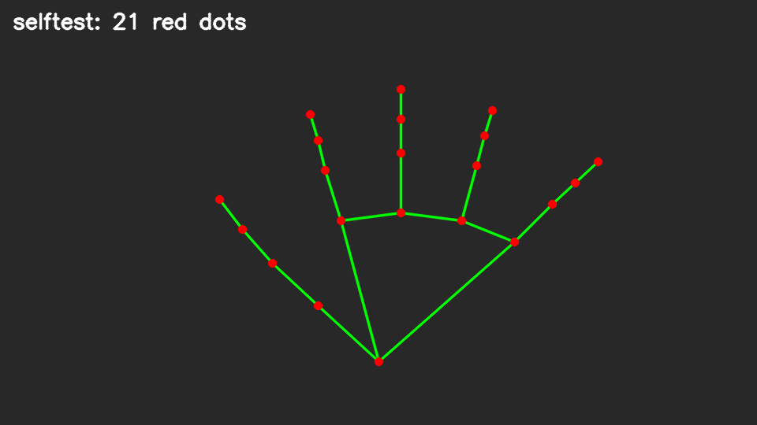

# 手部追踪（OpenCV + MediaPipe）

打开本地摄像头，实时检测手部，把 **21 个手部关键点用红色实心圆点**标在画面上，并叠加绿色骨骼连线。按 `q` 或 `Esc` 退出。


> 上图为程序对一张真实手部照片的实际输出（检测到两只手，各 21 个红点）。



> 上图为 `--selftest` 用假关键点渲染的结果，用于在不接摄像头的情况下确认「红点 + 连线」绘制正常。

---

## 1. 环境要求

- Windows 10/11 + Python **3.9 ~ 3.12**
- 一个能出画面的摄像头
- 首次安装需联网下载约 100 MB 依赖

本项目已在本机验证通过的版本组合：

| 组件 | 版本 |
| --- | --- |
| Python | 3.12.3 |
| mediapipe | **0.10.14**（不要升到 0.10.15+，见下） |
| opencv-contrib-python | 4.11.0.86 |
| numpy | 1.26.4 |

## 2. 安装依赖

双击 `setup.bat`，或在 cmd / 终端里执行：

```bat
cd /d D:\MYProject\hand_tracker
setup.bat
```

脚本做的事：用 `py -3.12` 创建 `.venv` → 把临时目录指到项目内 → 安装 `requirements.txt`。
实测从零安装约 **90 秒**。

> 想用 PowerShell 版也行：`.\setup.ps1`。但本机执行策略禁止未签名脚本，需要先
> `powershell -ExecutionPolicy Bypass -File .\setup.ps1`，所以推荐用 `.bat`。

手动安装等价于：

```bat
cd /d D:\MYProject\hand_tracker
py -3.12 -m venv .venv
.venv\Scripts\python.exe -m pip install -r requirements.txt
```

## 3. 运行

双击 `run.bat`，或在 cmd 里执行：

```bat
cd /d D:\MYProject\hand_tracker
run.bat
```

或直接用虚拟环境里的解释器：

```bat
.venv\Scripts\python.exe hand_tracker.py
```

窗口出现后把手放进画面 → 21 个红色圆点实时跟随手指关节。

**退出：** 按 `q` 或 `Esc`，也可直接关窗口（脚本会自动释放摄像头）。

## 4. 常用参数

| 参数 | 默认 | 作用 |
| --- | --- | --- |
| （不填 `--camera`） | 自动 | **自动扫描 0~5，选第一个能出画面的摄像头** |
| `--camera N` | — | 强制指定摄像头序号 |
| `--list-cameras` | — | 扫描并列出所有能打开的序号 |
| `--width / --height` | 1280 / 720 | 采集分辨率；调小能明显降低 CPU 占用 |
| `--max-hands` | 2 | 最多同时检测 1 或 2 只手 |
| `--no-mirror` | 关闭 | 默认镜像显示（像照镜子）；加此参数则原样显示 |
| `--no-connections` | 关闭 | **只要红点**，不画绿色骨骼线 |
| `--dot-radius` | 5 | 红点半径；觉得点太小就调大，如 `--dot-radius 8` |
| `--show-stats` | 关闭 | 叠加 FPS 和左右手标签（默认不显示，保持画面干净） |
| `--model-complexity` | 1 | 改成 `0` 换轻量模型，更快但精度略降 |
| `--probe out.png` | — | 无窗口自检：抓几帧、存一张标注图后退出 |
| `--selftest out.png` | — | 不碰摄像头，用假关键点渲染一张图，验证绘制代码 |

示例：

```bat
rem 只要红点，不要连线，点大一点
run.bat --no-connections --dot-radius 8

rem 指定摄像头 + 降分辨率求流畅
run.bat --camera 1 --width 640 --height 480

rem 验证摄像头链路（生成 probe_result.png）
run.bat --probe probe_result.png
```

## 5. 想改颜色 / 粗细

常量都在 `hand_tracker.py` 顶部，注意 OpenCV 用 **BGR** 顺序：

```python
DOT_COLOR = (0, 0, 255)        # 红色检测点
LINE_COLOR = (0, 255, 0)       # 绿色骨骼线
DOT_RADIUS = 5
LINE_THICKNESS = 2
```

例如「黄色点 + 不连线」：`DOT_COLOR = (0, 255, 255)` 再加 `--no-connections`。

## 6. 本机实测记录（踩过的坑）

这几条是装环境时真实遇到的，换机器不一定会碰到，但遇到了就知道怎么解：

1. **`mp.solutions` 报不存在**
   mediapipe **0.10.15 及以后已移除** `mp.solutions`（改用 Tasks API，还要另下 `hand_landmarker.task` 模型）。所以这里把版本锁在 `0.10.14`——它内置手部模型，不需要额外下载，纯离线可用。

2. **pip 安装无限卡住（不报错、CPU 空转）**
   PATH 里的 `python` 是**微软商店版**，而商店版建出来的 `.venv\Scripts\python.exe` 写不了系统 `%TEMP%`（`PermissionError`），pip 下载解包时就原地打转。
   解法：安装前把临时目录指到项目内（`setup.ps1` 已自动处理）：
   ```powershell
   $env:TMPDIR = "$PWD\.pip-tmp"; $env:TEMP = $env:TMPDIR; $env:TMP = $env:TMPDIR
   ```

3. **`pip install -r requirements.txt` 报 `UnicodeDecodeError: 'gbk' codec`**
   `requirements.txt` 里有中文注释、而 pip 在中文 Windows 上按 GBK 解码。现在文件已改成纯 ASCII 注释 + utf-8 编码声明。

4. **摄像头 0 号打不开**
   本机 `--list-cameras` 只找到 `index=2`，而且那是 **OBS 虚拟摄像头**（没开推流时只有一张占位图）。设备管理器里唯一的真实设备是 **Iriun Webcam**（手机当摄像头），需要手机端 App 连上才会出画面。因此程序默认改为**自动挑选可用摄像头**。

5. **`.\run.ps1` 报“未对文件进行数字签名”**
   本机 PowerShell 执行策略不允许运行未签名脚本。`.bat` 不受此限制，所以主入口用 `run.bat` / `setup.bat`；非要用 `.ps1` 就加 `-ExecutionPolicy Bypass`。

## 7. 常见问题

**红点完全不出现**
1. 先跑 `--probe probe_result.png`，看是「摄像头没画面」还是「检测不到手」。
2. 手太远 / 光线太暗 / 背景太杂都会降低检测率。把手放到画面中央、距离 40~80 cm、正面朝光。
3. 阈值调低：`--min-detection-confidence 0.3`。
4. 如果画面是 OBS 的占位图，那不是你的摄像头 —— 用 `--list-cameras` 换一个真的有画面的序号。

**画面卡顿、CPU 占用高**
- `--model-complexity 0`
- `--width 640 --height 480`
- `--max-hands 1`

**`pip install mediapipe` 报 No matching distribution**
用了 Python 3.13+。用 `py -3.12 -m venv .venv` 重建环境。

**中文输出乱码**
`run.ps1` / `setup.ps1` 里已经设置 `PYTHONIOENCODING=utf-8` 和控制台 UTF-8。手动运行时请先执行 `$env:PYTHONIOENCODING="utf-8"`，或改用 `.\run.ps1`。

**左右手标签反了**
镜像显示时程序会自动纠正标签。若用了 `--no-mirror`，标签与真人左右手一致。

## 8. 文件清单

| 文件 | 说明 |
| --- | --- |
| `hand_tracker.py` | 主程序（窗口模式 / `--probe` / `--selftest`） |
| `requirements.txt` | 依赖（mediapipe 锁定 0.10.14） |
| `setup.bat` | **一键建虚拟环境 + 装依赖**（含临时目录修复） |
| `run.bat` | **一键运行**（含中文编码修复） |
| `setup.ps1` / `run.ps1` | 同样的功能，PowerShell 版（需放开执行策略） |
| `demo_real_hand.png` | 真实照片检测效果 |
| `selftest.png` | 绘制逻辑自检输出 |
| `.venv/` | 已装好依赖的虚拟环境，可直接运行 |
